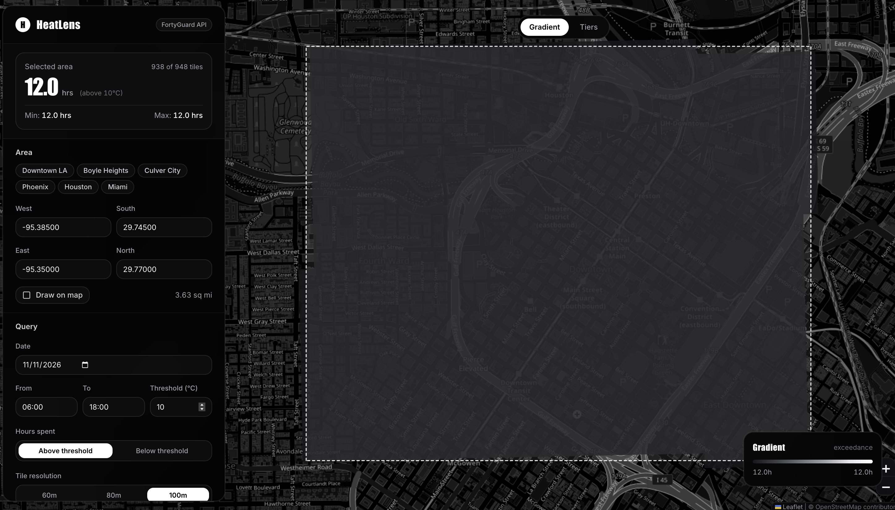
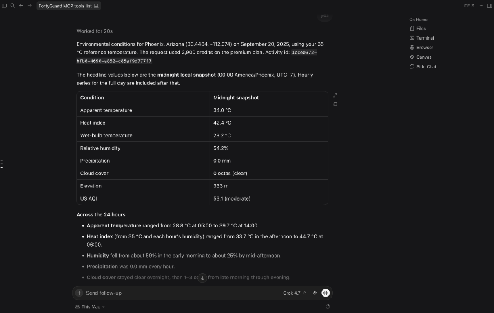

# HeatLens

HeatLens is a local web app for exploring heatmap data from the FortyGuard Temperature API. It uses FastAPI for the backend and React for the map interface.

## Project report

Read the [project report](docs/project-report.md) for a summary of the development process and current scope.

## Dashboard



## Features

- Preview and submit heatmap requests for a selected area.
- View completed results as a gradient or temperature bands.
- Save results locally and compare runs.

## FortyGuard MCP test

I tested the FortyGuard Temperature MCP in Cursor with an `env_params` request for Phoenix, Arizona. The response included environmental conditions for the selected date and reported a cost of 2,900 credits on the Premium plan.

This is evidence of the MCP response in the client, not an MCP integration in HeatLens or a view of the underlying tool-call trace. HeatLens currently connects to the FortyGuard REST API directly.



## Run the app

Create and activate a virtual environment, then install the Python dependencies:

```bash
python3 -m venv .venv
source .venv/bin/activate
python -m pip install -r requirements.txt
```

Create a `.env` file in the project root and add your API key:

```env
FORTYGUARD_API_KEY=your_api_key
```

Start the backend:

```bash
python -m uvicorn app.main:app --reload
```

Open [http://127.0.0.1:8000](http://127.0.0.1:8000). Run the offline tests with:

```bash
python -m pytest
```

## Frontend development

The built interface is included, so Node.js is only needed to work on the frontend. From the project root:

```bash
cd frontend
npm install
npm run dev
```

The development server runs at [http://localhost:5173](http://localhost:5173) and proxies API requests to the backend on port 8000. Build the interface into `app/static` with:

```bash
npm run build
```
